# 01 — Business process (As-Is / To-Be)

productivity-calendar-app-web (Calendar Board) คือปฏิทินรายเดือนฝั่งเบราว์เซอร์ที่ให้ผู้ใช้เลือกวัน เพิ่ม/ลบกิจกรรม (มี Undo) และเก็บใน `localStorage` ของเครื่องตัวเองเท่านั้น ไม่มีการซิงก์หรือแชร์ (รวมถึงระหว่างแท็บที่เปิดอยู่) มี `/api/mcp` แบบ stateless ที่ตอบเฉพาะตารางเดือน (`month_grid`) ไม่มีกิจกรรมของผู้ใช้

Last reviewed: 2026-11-28 · commit `d7d9a03`

## As-Is (จากโค้ดวันนี้)

```mermaid
flowchart LR
  V["Visitor opens /"] --> PRE["prerendered waiting card (date unknown on server)"]
  PRE --> TODAY["useToday: local date in browser"]
  TODAY --> BOARD["Board: 6x7 Sunday-first month grid, Prev / Today / Next"]
  BOARD --> LOAD["useStoredState: read localStorage calendar-app-events-v1"]
  LOAD --> PARSE{"parseEvents: valid array?"}
  PARSE -->|"missing, corrupt, not array"| DEMO["show one demo event on today"]
  PARSE -->|yes| KEEP["keep events with valid id, real date, title, notes; drop the rest"]
  DEMO --> PICK["select a day: side panel lists its events"]
  KEEP --> PICK
  PICK --> ADD["add event: title required (trimmed), notes optional"]
  ADD -->|"blank title"| NOADD["nothing added, Save disabled"]
  ADD -->|ok| SAVE["setItem localStorage; other open tabs are not updated"]
  PICK --> REM["remove event, Undo toast: 6 s countdown, paused while hovered or focused"]
  REM --> SAVE
  REM -->|"Undo pressed"| RESTORE["restore all removed events in the undoable set"]
  RESTORE --> SAVE
  SAVE -->|"storage blocked or full"| MEM["kept in memory for this page view"]
  MCP["POST /api/mcp"] --> TOOL["JSON-RPC initialize, tools/list, tools/call month_grid(year, month)"]
  TOOL -->|"bad JSON, unknown method or tool, bad year or month"| E["400 JSON-RPC error"]
```

Sources: `app/page.tsx`, `app/calendar-board.tsx`, `lib/calendar.ts`, `lib/use-today.ts`, `lib/use-stored-state.ts`, `app/api/mcp/route.ts`, `lib/sentry.ts`, `PRODUCT.md`

ข้อเท็จจริงจากโค้ด:

- แท็บที่เปิดอยู่พร้อมกันไม่ sync กัน: hook เก็บแคชต่อแท็บและไม่ฟัง `storage` event แท็บที่เห็นข้อมูลเก่าอาจเขียนทับของอีกแท็บ
- ข้อมูลกิจกรรมไม่ออกจากเบราว์เซอร์ ยกเว้นรายงาน error ไป Sentry เมื่อมี `NEXT_PUBLIC_SENTRY_DSN` (`beforeSend` ลบ request, user, breadcrumbs, extra, ตัด query/hash ใน URL และข้อความ error, ไม่ส่ง performance transaction)
- ไม่มีการแก้ไขกิจกรรมเดิม ไม่มีเวลา การแจ้งเตือน หรือ recurrence; ล้าง site data แล้วกิจกรรมหาย
- เซิร์ฟเวอร์ไม่มีกิจกรรมของผู้ใช้ เพราะข้อมูลอยู่ในเบราว์เซอร์; `month_grid` ใช้ logic ตารางเดือนเดียวกับหน้าเว็บ
- `PRODUCT.md` ระบุว่า Vercel project ผูก Git แล้ว (push ไป main = deploy) และตั้ง Sentry DSN แล้ว ณ 2026-11; ยืนยันจากโค้ดไม่ได้ [ต้องยืนยัน]

## To-Be (ไม่มี)

ไม่มี To-Be ที่เขียนไว้ เอกสารใน repo (`PRODUCT.md` §Known limits) ระบุเฉพาะข้อจำกัดที่รับไว้ก่อนและยังไม่แก้ ไม่ได้เขียนเป็นสถานะเป้าหมายของกระบวนการ

## Gap

| ID | As-Is → To-Be | Status | Owner | Evidence |
|---|---|---|---|---|
| G1 | ปุ่มวันกว้างประมาณ 36px ที่ 320px (เป้าหมายขั้นต่ำ 44px ตาม APP-SHELL.md) | todo | claude | `PRODUCT.md` §Known limits; `APP-SHELL.md` |
| G2 | ข้อความ "Undo is available" ค้างใน status region หลัง toast หมดเวลา และยังไม่ได้ตรวจ Undo ด้วยเบราว์เซอร์/screen reader จริง (ทดสอบด้วย happy-dom เท่านั้น) | todo | claude | `PRODUCT.md` §Known limits (Codex review 2026-11-19) |
| G3 | ไม่มี To-Be ของกระบวนการ (เช่น แก้ไขกิจกรรม เวลา การแจ้งเตือน) → owner กำหนด | decide | owner | ไม่มีใน `PRODUCT.md` / `specs/`; `PRODUCT.md` §What does not work |

## Open questions

- ผลิตภัณฑ์ต้องการขยายเกินปฏิทินส่วนตัวในเครื่องเดียวหรือไม่ (G3)
